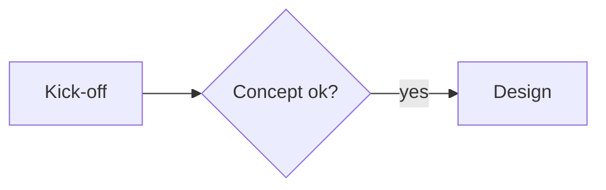

# real·fast·document

[Deutsch](README.md) · **English**

[](https://github.com/jcmx9/real-fast-document/actions/workflows/ci.yml)

> From a Markdown file to an archivable, consistently designed **PDF/A-3b** —
> no word processor, no manual layout.

real·fast·document (command `rf-document`) typesets Markdown with **Typst** into a fixed
corporate layout: A4, title block, running header with chapter and logo, footer with page
count. The result is **PDF/A-3b** with the Markdown source embedded. Everything runs
**offline** — fonts and Typst packages live in the project, no Pandoc needed.


## What it does

- **Documents with a fixed layout:** title block with client, title, subtitle, date and author;
  header with the current chapter and logo; footer with name, page and date; table of contents
  and chapter page breaks automatically for longer documents; optional watermark.
- **Markdown as usual — and more:** CommonMark with tables, footnotes, math, code and
  definition lists, plus callout boxes (`> [!NOTE]`, `> [!HINWEIS]`), task tables
  (`- [ ] Task – Name, due date`), highlights (`==text==`), page breaks, date lines, Mermaid
  diagrams and, on request, hard line breaks.
- **Clean typography:** variable Adobe Source fonts, quotes by language, en and em dashes,
  ellipses, non-breaking spaces, old-style figures in text and lining figures in tables.
- **Archivable:** PDF/A-3b, source as an attachment (optional), reproducible PDF date.
- **Usable everywhere:** terminal command `rf-document`, right-click in the file manager and
  calls from other programs (e.g. as a Zettlr export) — on macOS, Linux and Windows.

## Installation & update

The only prerequisite is **git**. **One command installs — the same command updates.**

**macOS / Linux:**

```bash
curl -fsSL https://raw.githubusercontent.com/jcmx9/real-fast-document/main/scripts/bootstrap.sh | bash
```

**Windows (PowerShell):**

```powershell
irm https://raw.githubusercontent.com/jcmx9/real-fast-document/main/scripts/bootstrap.ps1 | iex
```

On the first run the command clones the project into `~/.local/share/real-fast-document`
(Windows: `%LOCALAPPDATA%\real-fast-document`), installs Typst (≥ 0.15), downloads fonts and
Typst packages and sets up the right-click entry and the terminal command `rf-document`. Every
further run updates the installation; fonts and packages already present are not downloaded
again.

Typst comes from the system package manager (Homebrew, apt, dnf, pacman, winget). If it is
missing there or older than 0.15, the installer downloads the official Typst binary into
`./bin`.

**Manual (for development):**

```bash
git clone https://github.com/jcmx9/real-fast-document.git
cd real-fast-document
bash scripts/install.sh      # Windows: ./scripts/install.ps1
```

## Uninstall

One command removes the right-click entry, the terminal command `rf-document` **and** the
install folder (program, fonts, packages, logo — back up a custom logo first). Typst stays, it
belongs to the package manager.

**macOS / Linux:**

```bash
curl -fsSL https://raw.githubusercontent.com/jcmx9/real-fast-document/main/scripts/bootstrap.sh | bash -s -- --uninstall
```

**Windows (PowerShell):**

```powershell
& ([scriptblock]::Create((irm https://raw.githubusercontent.com/jcmx9/real-fast-document/main/scripts/bootstrap.ps1))) -Uninstall
```

## Quick start

```markdown
---
title: "Kick-off relaunch"
client: "Example Ltd"
date: 2026-10-13
lang: en
---

# Agenda

Meeting with the client.

- [ ] Draft the sitemap – Ben Probe, due 17 Oct
```

```bash
rf-document note.md    # -> 2026-10-13_note.pdf next to the note
```

A template with **all** settings is [`header.md`](header.md); a tour of every feature is
[`example.md`](example.md).

## Usage

### Terminal

```bash
rf-document note.md                # PDF next to the note
rf-document note.md target.pdf     # exactly this path
rf-document --no-source note.md    # without source in PDF
rf-document --hard-breaks note.md  # every line stays a line
rf-document --help                 # all options
```

Inside the project the same works with `bash scripts/build.sh …` (without an argument it
builds `example.md`).

**Output name:** without a second argument the PDF lands next to the source. With `date:` in
the frontmatter it gets an ISO prefix (`2026-10-13_note.pdf`), which `isodate_praefix: false`
disables. An explicitly given output path is written exactly as given. After the build the PDF
opens in the default viewer.

| Option | Effect |
|--------|--------|
| `--no-source` | Do **not** embed the Markdown source (e.g. client PDFs); same as `embed_source: false` |
| `--hard-breaks` | Every line stays a line, as typed in the editor; same as `hard_breaks: true` |
| `--version`, `-V` | Print rf-document and Typst version |
| `--help`, `-h` | Print help |

On Windows the same options apply, plus `-Version` and `-Help`.

| Environment variable | Effect |
|----------------------|--------|
| `RFD_NO_OPEN=1` | Do not open the PDF after the build (batch, cron, other programs) |
| `RFD_BASE_DIR=folder` | Image and logo paths relative to this folder instead of the source's folder |
| `TYPST=/path/typst` | Use a specific Typst binary (≥ 0.15) |
| `SOURCE_DATE_EPOCH` | Fix the PDF date when no `date:` is set |

### Right-click

After installation a right-click entry is available; the PDF lands next to the source.

- **macOS:** right-click `.md` → **Services / Quick Actions → “Nach PDF-A (real-fast-document)”**
- **Linux:** right-click `.md` → **Open with → “Nach PDF-A (real-fast-document)”**
- **Windows:** select `.md` → right-click → **Send to → “Nach PDF-A (real-fast-document)”**

### From other programs (e.g. Zettlr)

`rf-document` is built as an export target:

- The exit code is 0 only on success; errors and warnings go briefly (in German) to stderr.
- Typst is found even with a minimal `PATH` (started from a GUI app).
- Input and output may be absolute paths with spaces; the working directory does not matter.
- For a temporary copy of the note (Zettlr with unsaved changes) `RFD_BASE_DIR` points to the
  real note folder so images and logo are found.
- On Windows the same call goes through `rf-document.cmd`; CI checks it under Windows
  PowerShell 5.1.

```bash
RFD_NO_OPEN=1 RFD_BASE_DIR="/path/to/note" rf-document --no-source --hard-breaks "/path/note.md" "/path/target.pdf"
```

## Frontmatter

A YAML block at the start of the file controls individual documents. All keys are optional;
**[`header.md`](header.md)** contains every key with its default value and a (German) comment.

```yaml
---
title: "Kick-off relaunch"   # title: title block, header, PDF title
subtitle: "Workshop"         # subtitle
client: "Example Ltd"        # client, small and letter-spaced above the title
author: [Anna, Ben]          # author(s): line "date · author"
date: 2026-10-13             # date (ISO or D.M.YYYY)
lang: en                     # language; default de
watermark: "DRAFT"           # watermark
embed_source: false          # do not embed the source
hard_breaks: true            # every line stays a line
---
```

| Key | Values | Default | Effect |
|-----|--------|---------|--------|
| `title` | text | — | Title block on top, header from page 1, PDF metadata title. Without `title` there is no title block; the PDF title is then the file name. `# …` in the text is always a chapter, never the title. |
| `subtitle` | text | — | Subtitle below the title. |
| `client` | text | — | Client/company, small and letter-spaced above the title. |
| `author` | text or `[A, B]` | — | Line below the title: “date · author”. |
| `date` | `2026-10-13` or `13.10.2026` | — | Date bottom right (per `lang`), ISO prefix on the file name, fixed PDF date. An unrecognized date is shown as is, without a prefix. |
| `isodate_praefix` | `true` / `false` | `true` | ISO prefix on the file name when `date` is set. |
| `lang` | `de`, `en`, … | `de` | Language: date, hyphenation, quotes, labels (Seite/Page, Inhalt/Contents, Aufgabe/Task, callouts). |
| `toc` | `auto` / `true` / `false` | `auto` | Table of contents (H1 + H2 only); `auto` above five H1/H2. |
| `h1_break` | `auto` / `true` / `false` | `auto` | Every chapter (`#`) on a new page; `auto` as for `toc`. |
| `header` | text | — | Fixed header text from page 1 instead of the running chapter. |
| `print_filename` | `true` / `false` | `true` | Show/hide the bottom-left entry (file name or “client · title”). |
| `watermark` | text | — | Diagonal light-gray watermark beneath everything. |
| `logo` | path | global logo | Logo for this document only (PNG/JPG/SVG), relative to the note or absolute. Missing file: warning, global logo. |
| `logo-height` | `20mm`, `1.5cm`, `40pt`, … | `20mm` | Maximum logo height (at most 25 mm); the logo keeps its proportions and is at most 60 mm wide. |
| `embed_source` | `true` / `false` | `true` | Embed the Markdown source as an attachment. |
| `hard_breaks` | `true` / `false` | `false` | Every line break stays one (as typed in Zettlr/Obsidian). |

**Rules:** empty values (`subtitle: ""` or just `subtitle:`) are ignored, never an error.
Yes/no keys accept `true`/`false`, `yes`/`no`, `on`/`off` in any case; an unrecognized value
produces a warning and the default applies. Comments (`# …`) may stand on their own lines and
after values. In paths (`logo:`, images) `~`, `$VAR`, `${VAR}` and `%VAR%` are expanded.

## Markdown

CommonMark works as usual — `*italic*`, `**bold**`, `` `code` ``, links, lists, quotes,
footnotes, tables. Headings and lists need no blank line before them. The following sections
describe what applies beyond that.

### Text & typography

| Input | Result |
|-------|--------|
| `"quote"`, `'quote'` | by language: `lang: de` „quote“ ‚quote‘, otherwise “quote” ‘quote’ |
| `it's` | it’s (apostrophe) |
| `„…“`, `‚…‘`, `»…«`, `“…”` | typed characters stay exactly as they are |
| `3--5`, `9--17 Uhr` | en dash as a range: 3–5, 9–17 Uhr |
| `pause -- then go on` | en dash as a spaced dash: pause – then go on |
| `word---word` | em dash: word—word |
| `...` | ellipsis: … |
| `==highlight==` | yellowish background |
| `~~strikethrough~~` | strikethrough |
| `z. B.`, `5 %`, `12 pt`, `1.234,56 €` | non-breaking spaces, no line break in between |
| `<!-- pagebreak -->`, `\newpage` | page break (own line) |
| `18. Oktober 2026` at a line start | stays a date, not a numbered list starting at 18 |

Code, math and HTML are left alone by the typography. Running text uses old-style figures,
tables use equal-width lining figures.

**Line breaks:** the default is CommonMark — a single break becomes a space, two spaces or `\`
at the line end force a break. With `hard_breaks: true` (or `--hard-breaks`) every line stays a
line.

### Title, headings and structure

- The **title** comes from `title:` — centered on top, in the header, in the PDF title.
- `#` is a **chapter**: fine line below, runs in the header, optionally a new page.
- `##` and `###` are subsections (`###` finely underlined), `####` and deeper italic.
- **Automatism:** with more than five `#`/`##` headings a table of contents (H1 + H2) appears
  and each chapter starts on a new page. `toc` and `h1_break` switch both individually.
- **Header:** `header:` (fixed text) before the current chapter before the title.
- **Footer:** left the file name or “client · title” (as soon as `client` or `subtitle` is
  set), page number, right the date. Entries that are too long are shortened with “…”.

### Lists and tasks

Bullet lists (a small square on all levels), numbered and nested lists work as usual.
**Tasks:**

```markdown
- [ ] Draft the sitemap – Ben Probe, due 17 Oct
- [x] Fix the date – Anna Beispiel
- [ ] Clear image rights – by Friday
```

A list made **only** of tasks becomes a table *Task · Owner · Due · Status* (German *Aufgabe ·
Wer · Bis · Status*). Owner and due date follow a dash (`–`, `—` or ` - `), the date follows
`bis`, `due` or `by`. Columns that would be empty everywhere are dropped. In mixed lists a box
replaces the bullet; done boxes are filled dark with a check mark.

Snippet template: `- [ ] ${1:Task} – ${2:Name}, due ${3:Date}$0`

### Callout boxes

```markdown
> [!WARNING]
> Text of the box, also with **emphasis** and lists.
```

| GitHub keyword | German keyword | Title (de / en) | Color |
|----------------|----------------|-----------------|-------|
| `[!NOTE]` | `[!INFO]` | Info / Note | blue `#2f6aa8` |
| `[!TIP]` | `[!TIPP]` | Tipp / Tip | green `#3b7d3a` |
| `[!IMPORTANT]` | `[!WICHTIG]` | Wichtig / Important | violet `#7a4fb0` |
| `[!WARNING]` | `[!HINWEIS]` | Hinweis / Warning | orange `#b05a1a` |
| `[!CAUTION]` | `[!ACHTUNG]` | Achtung / Caution | red `#b5452b` |

A box never splits across pages. A quote without a keyword stays an indented, italic quote.

### Tables

Pipe tables in a compact table type (9 pt Medium). Each column is as wide as its content; small
tables stay narrow, when space runs out text-heavy columns wrap. Columns made only of numbers
or amounts are right-aligned; the alignment from the separator row (`:--`, `--:`, `:-:`) wins.
The header repeats on following pages; words are not hyphenated in cells. Every table form is
shown in [`tests/fixtures/tables-showcase.md`](tests/fixtures/tables-showcase.md).

### Images

```markdown
{width=50%}
```

- With alt text a numbered figure with caption, without alt text just the image.
- Width via `{width=…}` in `%`, `mm`, `cm`, `in`, `pt` or `px`.
- Paths relative to the note (or to `RFD_BASE_DIR`) or absolute; `~`, `$VAR`, `${VAR}`,
  `%VAR%` are expanded.
- A **missing image never aborts the export**: the PDF shows “[Bild fehlt: path]” (“[Image
  missing: path]” with `lang: en`), stderr a warning.
- **Remote images** (`http(s)://`, `data:`) are dropped offline; the build reports how many.
- On Windows only images on the install drive are reachable.

### Diagrams

````markdown

````

Mermaid diagrams are drawn offline (Typst package **mmdr**), in calm colors and with the
variable Source Sans 3. Broken syntax does not abort the export.

### Math, code, footnotes, definition lists

- **Math** in LaTeX syntax: `$E = mc^2$` inline, `$$ … $$` displayed.
- **Code** with syntax highlighting in Source Code Pro.
- **Footnotes** (`[^1]`) sit at the page foot with a hanging indent.
- **Definition lists** in Pandoc style: term, below it `: explanation`.

### Special characters and emoji

Characters Source does not have come individually from **Noto Emoji** and **Noto Sans
Symbols 2** — monochrome, PDF/A-safe: 🚀 ✓ ⚠ → ★ ½ €.

## Layout

| Aspect | Value |
|--------|-------|
| Format | A4 portrait |
| Margins | left 35 mm · right 30 mm · top 35 mm · bottom 20 mm (text block 145 mm, ~95 characters per line) |
| Header | chapter or `header:` on the left (sans), logo on the right within at most 20 × 60 mm, line below |
| Footer | line; name left · page · date right (without date: name · page) |
| Title block | centered: client (letter-spaced), title, subtitle, “date · author” |
| Headings | Source Serif 4, left-aligned; only H1 with a fine line; never left alone at a page foot |
| Body text | justified with hyphenation; widows and orphans are avoided |
| Tables | header centered and bold with a line, light zebra, vertical separators |
| Figures | image and caption stay together |
| Watermark | diagonal, letter-spaced, bold, light gray (pure gray, clean in print) |

| Element | Font | Size |
|---------|------|------|
| Body text | Source Sans 3 (`wght` 380), bold 560 | 10 pt, line spacing 0.85 em |
| Title | Source Serif 4 (`wght` 470) | 16 pt |
| Chapter (H1) | Source Serif 4 (`wght` 470) | 14 pt |
| H2 | Source Serif 4 (`wght` 470) | 12 pt |
| H3 / H4+ | Source Serif 4 (`wght` 380), underlined / italic | 10 pt |
| Table of contents | Source Serif 4 / Source Sans 3 | 14 pt / 11 pt |
| Header | Source Sans 3 | 11 pt |
| Tables | Source Sans 3 Medium (`wght` 500), tracking −2 % | 9 pt |
| Code / caption / footer | Source Code Pro / Source Sans 3 | 9 pt |

## PDF/A, source and metadata

- **PDF/A-3b**, all fonts embedded.
- The **Markdown source** is attached to the PDF (under its file name, without a local path)
  and can be extracted again, e.g. with `mutool extract file.pdf`. Disable with
  `embed_source: false` or `--no-source`.
- The **PDF date** is the note's `date:`, otherwise the source's modification time — never the
  build time.
- **Further metadata:** title from `title:` (otherwise the file name), author from `author:`,
  description from `subtitle:`, language from `lang:`; the keywords contain the client and
  “rf-document <version>”. Typst records itself as the creating program (“Typst 0.15.0”); that
  field cannot be changed.

## Fonts

Only the **variable Source fonts from Adobe** (Source Serif 4, Source Sans 3, Source Code Pro;
weights via the `wght` axis). For characters without a Source glyph **Noto Emoji** (variable)
and **Noto Sans Symbols 2** step in individually, both monochrome. Details:
[fonts/README.md](fonts/README.md).

## Customizing

- **Global logo:** `logo.svg`, `logo.png` or `logo.jpg` in the install folder
  (`~/.local/share/real-fast-document`, Windows `%LOCALAPPDATA%\real-fast-document`); the first
  existing file is used. Without a logo rf-document continues with a note. Per document:
  `logo:` in the frontmatter.
- **Margins, fonts, colors, font sizes:** collected at the top of `template.typ`.
- **PDF/A level:** `standard` in `scripts/build.sh` (`a-1b`, `a-2b`, `a-3b`); embedding the
  source requires `a-3b`.
- **Package versions:** cmarker, mitex and mmdr are pinned in `scripts/fetch-typst-packages.sh`
  and `scripts/install.ps1`.

## Development

```
template.typ                layout and cmarker call
lib/markdown.typ            Markdown preprocessing (identical on all systems)
scripts/build.sh            converter macOS/Linux: frontmatter, paths, invocation
scripts/convert.ps1         converter Windows ("Send to", rf-document.cmd)
scripts/install.sh|.ps1     setup: Typst, fonts, packages, right-click, command
scripts/bootstrap.sh|.ps1   one-command install, update and uninstall
scripts/rfd-convert.sh      right-click dispatcher (macOS/Linux)
scripts/fetch-fonts.sh      downloads the fonts into ./fonts
scripts/fetch-typst-packages.sh  downloads cmarker, mitex, mmdr into ./vendor
scripts/test-pdf.sh         end-to-end tests (macOS/Linux)
scripts/test-windows.ps1    Windows tests (CI, Windows PowerShell 5.1)
tests/fixtures/             test notes, incl. tables-showcase.md (every table form)
example.md                  tour of every feature
header.md                   frontmatter template with every key
fonts/, assets/, logo.svg   fonts, example graphic, default logo
```

**Tests:** `bash scripts/test-pdf.sh` builds every test note and checks the PDF text, the table
geometry and the interface (output path, exit codes, embedded source, minimal `PATH`, paths
with spaces, `RFD_BASE_DIR`). Requires `pdftotext` (poppler) or `mutool` (mupdf). CI runs them
on Linux, plus `scripts/test-windows.ps1` on Windows.

## Versioning

[CalVer](https://calver.org/) in the format `YY.M.MICRO` — see `VERSION` and
[CHANGELOG.md](CHANGELOG.md).

## License

MIT — see [LICENSE](LICENSE). The fonts under `fonts/` are licensed under the SIL Open Font
License 1.1 ([fonts/README.md](fonts/README.md)); the packages under `vendor/` carry their own
licenses (cmarker: MIT, mitex: Apache-2.0, mmdr: MIT).
