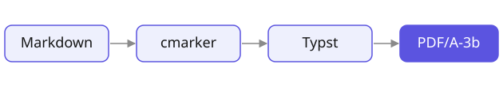
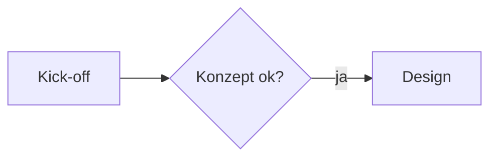

# real·fast·document

**Deutsch** · [English](README.en.md)

[](https://github.com/jcmx9/real-fast-document/actions/workflows/ci.yml)

> Aus einer Markdown-Datei ein archivfähiges, einheitlich gestaltetes **PDF/A-3b** —
> ohne Textverarbeitung, ohne manuelles Layout.

real·fast·document (Befehl `rf-document`) setzt Markdown mit **Typst** in ein festes
Corporate-Layout: DIN A4, Titelblock, laufender Kopf mit Kapitel und Logo, Fußzeile mit
Seitenzählung. Das Ergebnis ist **PDF/A-3b** mit eingebetteter Markdown-Quelle. Alles läuft
**offline** — Schriften und Typst-Packages liegen im Projekt, Pandoc wird nicht gebraucht.



## Was es kann

- **Dokumente mit festem Layout:** Titelblock mit Kunde, Titel, Untertitel, Datum und Autor;
  Kopfzeile mit aktuellem Kapitel und Logo; Fußzeile mit Name, Seite und Datum;
  Inhaltsverzeichnis und Kapitel-Seitenumbruch automatisch ab längeren Dokumenten;
  optionales Wasserzeichen.
- **Markdown wie gewohnt — und mehr:** CommonMark mit Tabellen, Fußnoten, Formeln, Code und
  Definitionslisten, dazu Hinweisboxen (`> [!NOTE]`, `> [!HINWEIS]`), Aufgabentabellen
  (`- [ ] Aufgabe – Name, bis Datum`), Markierungen (`==Text==`), Seitenumbrüche,
  Datumszeilen, Mermaid-Diagramme und auf Wunsch harte Zeilenumbrüche.
- **Saubere Typografie:** variable Adobe-Source-Schriften, Anführungszeichen nach Sprache,
  Halbgeviert- und Geviertstriche, Auslassungszeichen, geschützte Leerzeichen, Mediävalziffern
  im Text und Versalziffern in Tabellen.
- **Archivfähig:** PDF/A-3b, Quelle als Anhang (abschaltbar), reproduzierbares PDF-Datum.
- **Überall nutzbar:** Terminal-Befehl `rf-document`, Rechtsklick im Dateimanager und Aufruf
  aus anderen Programmen (z. B. als Zettlr-Export) — auf macOS, Linux und Windows.

## Installation & Update

Einzige Vorbedingung ist **git**. **Ein Befehl installiert — derselbe Befehl aktualisiert.**

**macOS / Linux:**

```bash
curl -fsSL https://raw.githubusercontent.com/jcmx9/real-fast-document/main/scripts/bootstrap.sh | bash
```

**Windows (PowerShell):**

```powershell
irm https://raw.githubusercontent.com/jcmx9/real-fast-document/main/scripts/bootstrap.ps1 | iex
```

Beim ersten Aufruf klont der Befehl das Projekt nach `~/.local/share/real-fast-document`
(Windows: `%LOCALAPPDATA%\real-fast-document`), installiert Typst (≥ 0.15), lädt Schriften
und Typst-Packages und richtet den Rechtsklick-Eintrag sowie den Terminal-Befehl
`rf-document` ein. Jeder weitere Aufruf aktualisiert die Installation; schon vorhandene
Schriften und Packages werden nicht erneut geladen.

Typst kommt über den System-Paketmanager (Homebrew, apt, dnf, pacman, winget). Fehlt es dort
oder ist es älter als 0.15, lädt der Installer das offizielle Typst-Binary nach `./bin`.

**Manuell (für die Entwicklung):**

```bash
git clone https://github.com/jcmx9/real-fast-document.git
cd real-fast-document
bash scripts/install.sh      # Windows: ./scripts/install.ps1
```

## Deinstallation

Ein Befehl entfernt den Rechtsklick-Eintrag, den Terminal-Befehl `rf-document` **und** den
Installordner (Programm, Schriften, Packages, Logo — ein eigenes Logo vorher sichern). Typst
bleibt, es gehört dem Paketmanager.

**macOS / Linux:**

```bash
curl -fsSL https://raw.githubusercontent.com/jcmx9/real-fast-document/main/scripts/bootstrap.sh | bash -s -- --uninstall
```

**Windows (PowerShell):**

```powershell
& ([scriptblock]::Create((irm https://raw.githubusercontent.com/jcmx9/real-fast-document/main/scripts/bootstrap.ps1))) -Uninstall
```

## Schnellstart

```markdown
---
title: "Kick-off Relaunch"
client: "Muster GmbH"
date: 2026-10-13
---

# Agenda

Besprechung mit dem Kunden.

- [ ] Sitemap erstellen – Ben Probe, bis 17.10.
```

```bash
rf-document notiz.md    # -> 2026-10-13_notiz.pdf neben der Notiz
```

Eine Vorlage mit **allen** Einstellungen ist [`header.md`](header.md); ein Rundgang durch
alle Funktionen ist [`example.md`](example.md).

## Verwendung

### Terminal

```bash
rf-document notiz.md                # PDF neben der Notiz
rf-document notiz.md ziel.pdf       # genau dieser Pfad
rf-document --no-source notiz.md    # ohne Quelle im PDF
rf-document --hard-breaks notiz.md  # Zeile bleibt Zeile
rf-document --help                  # alle Optionen
```

Im Projektordner funktioniert dasselbe mit `bash scripts/build.sh …` (ohne Argument wird
`example.md` gebaut).

**Ausgabename:** Ohne zweites Argument landet das PDF neben der Quelle. Mit `date:` im
Frontmatter bekommt es einen ISO-Präfix (`2026-10-13_notiz.pdf`), abschaltbar mit
`isodate_praefix: false`. Ein ausdrücklich angegebener Ausgabepfad wird exakt so geschrieben.
Nach dem Build öffnet sich das PDF im Standardprogramm.

| Option | Wirkung |
|--------|---------|
| `--no-source` | Markdown-Quelle **nicht** ins PDF einbetten (z. B. Kunden-PDFs); wie `embed_source: false` |
| `--hard-breaks` | Jede Zeile bleibt eine Zeile, wie im Editor getippt; wie `hard_breaks: true` |
| `--version`, `-V` | rf-document- und Typst-Version ausgeben |
| `--help`, `-h` | Hilfe ausgeben |

Unter Windows gelten dieselben Optionen, zusätzlich `-Version` und `-Help`.

| Umgebungsvariable | Wirkung |
|-------------------|---------|
| `RFD_NO_OPEN=1` | PDF nach dem Build nicht öffnen (Batch, Cron, andere Programme) |
| `RFD_BASE_DIR=ordner` | Bild- und Logopfade relativ zu diesem Ordner statt zum Ordner der Quelle |
| `TYPST=/pfad/typst` | bestimmtes Typst-Binary verwenden (≥ 0.15) |
| `SOURCE_DATE_EPOCH` | PDF-Datum festlegen, wenn kein `date:` gesetzt ist |

### Rechtsklick

Nach der Installation steht ein Rechtsklick-Eintrag bereit; das PDF landet neben der Quelle.

- **macOS:** `.md` rechtsklicken → **Dienste / Quick Actions → „Nach PDF-A (real-fast-document)“**
- **Linux:** `.md` rechtsklicken → **Öffnen mit → „Nach PDF-A (real-fast-document)“**
- **Windows:** `.md` markieren → Rechtsklick → **Senden an → „Nach PDF-A (real-fast-document)“**

### Aus anderen Programmen (z. B. Zettlr)

`rf-document` ist als Exportziel gebaut:

- Der Exit-Code ist nur bei Erfolg 0; Fehler und Warnungen gehen kurz und auf Deutsch auf stderr.
- Typst wird auch mit minimalem `PATH` gefunden (Start aus einer GUI-App).
- Ein- und Ausgabe dürfen absolute Pfade mit Leerzeichen sein, das Arbeitsverzeichnis ist egal.
- Bei einer temporären Kopie der Notiz (Zettlr mit ungespeicherten Änderungen) zeigt
  `RFD_BASE_DIR` auf den echten Notizordner, damit Bilder und Logo gefunden werden.
- Unter Windows läuft derselbe Aufruf über `rf-document.cmd`; die CI prüft das unter Windows
  PowerShell 5.1.

```bash
RFD_NO_OPEN=1 RFD_BASE_DIR="/pfad/zur/notiz" rf-document --no-source --hard-breaks "/pfad/notiz.md" "/pfad/ziel.pdf"
```

## Frontmatter

Ein YAML-Block am Dateianfang steuert einzelne Dokumente. Alle Schlüssel sind optional;
**[`header.md`](header.md)** enthält jeden Schlüssel mit Standardwert und Kommentar.

```yaml
---
title: "Kick-off Relaunch"   # Titel: Titelblock, Kopfzeile, PDF-Titel
subtitle: "Workshop"         # Untertitel
client: "Muster GmbH"        # Kunde, klein und gesperrt über dem Titel
author: [Anna, Ben]          # Autor(en): Zeile "Datum · Autor"
date: 13.10.2026             # Datum (ISO oder T.M.JJJJ)
lang: de                     # Sprache; Standard de
watermark: "ENTWURF"         # Wasserzeichen
embed_source: false          # Quelle nicht einbetten
hard_breaks: true            # Zeile bleibt Zeile
---
```

| Schlüssel | Werte | Standard | Wirkung |
|-----------|-------|----------|---------|
| `title` | Text | — | Titelblock oben, Kopfzeile ab Seite 1, PDF-Metadatentitel. Ohne `title` kein Titelblock; der PDF-Titel ist dann der Dateiname. `# …` im Text ist immer ein Kapitel, nie der Titel. |
| `subtitle` | Text | — | Untertitel unter dem Titel. |
| `client` | Text | — | Kunde/Firma, klein und gesperrt über dem Titel. |
| `author` | Text oder `[A, B]` | — | Zeile unter dem Titel: „Datum · Autor“. |
| `date` | `2026-10-13` oder `13.10.2026` | — | Datum unten rechts (nach `lang`), ISO-Präfix am Dateinamen, festes PDF-Datum. Ein nicht erkanntes Datum erscheint unverändert, ohne Präfix. |
| `isodate_praefix` | `true` / `false` | `true` | ISO-Präfix am Dateinamen, wenn `date` gesetzt ist. |
| `lang` | `de`, `en`, … | `de` | Sprache: Datum, Silbentrennung, Anführungszeichen, Beschriftungen (Seite/Page, Inhalt/Contents, Aufgabe/Task, Hinweisboxen). |
| `toc` | `auto` / `true` / `false` | `auto` | Inhaltsverzeichnis (nur H1 + H2); `auto` ab mehr als fünf H1/H2. |
| `h1_break` | `auto` / `true` / `false` | `auto` | Jedes Kapitel (`#`) auf neuer Seite; `auto` wie bei `toc`. |
| `header` | Text | — | Fester Kopfzeilentext ab Seite 1 statt des laufenden Kapitels. |
| `print_filename` | `true` / `false` | `true` | Angabe unten links (Dateiname bzw. „Kunde · Titel“) ein-/ausblenden. |
| `watermark` | Text | — | Diagonales, hellgraues Wasserzeichen unter allem. |
| `logo` | Pfad | globales Logo | Logo nur für dieses Dokument (PNG/JPG/SVG), relativ zur Notiz oder absolut. Fehlt die Datei: Warnung, globales Logo. |
| `logo-height` | `20mm`, `1.5cm`, `40pt`, … | `20mm` | Maximale Logohöhe (höchstens 25 mm); das Logo bleibt proportional und höchstens 60 mm breit. |
| `embed_source` | `true` / `false` | `true` | Markdown-Quelle als Anhang ins PDF einbetten. |
| `hard_breaks` | `true` / `false` | `false` | Jeder Zeilenumbruch bleibt einer (wie in Zettlr/Obsidian getippt). |

**Regeln:** Leere Werte (`subtitle: ""` oder nur `subtitle:`) werden ignoriert, nie ein Fehler.
Ja/Nein-Schlüssel verstehen `true`/`false`, `yes`/`no`, `on`/`off` in jeder Schreibweise; ein
nicht erkannter Wert erzeugt eine Warnung, der Standard bleibt. Kommentare (`# …`) dürfen auf
eigenen Zeilen und hinter Werten stehen. In Pfaden (`logo:`, Bilder) werden `~`, `$VAR`,
`${VAR}` und `%VAR%` ersetzt.

## Markdown

CommonMark funktioniert wie gewohnt — `*kursiv*`, `**fett**`, `` `Code` ``, Links, Listen,
Zitate, Fußnoten, Tabellen. Überschriften und Listen brauchen keine Leerzeile davor. Die
folgenden Abschnitte beschreiben, was darüber hinaus gilt.

### Text & Typografie

| Eingabe | Ergebnis |
|---------|----------|
| `"Zitat"`, `'Zitat'` | nach Sprache: `lang: de` „Zitat“ ‚Zitat‘, sonst “Zitat” ‘Zitat’ |
| `geht's` | geht’s (Apostroph) |
| `„…“`, `‚…‘`, `»…«`, `“…”` | getippte Zeichen bleiben exakt erhalten |
| `3--5`, `Wort---Wort`, `...` | 3–5, Wort—Wort, … |
| `==Markierung==` | gelblich hinterlegt |
| `~~durchgestrichen~~` | durchgestrichen |
| `z. B.`, `5 %`, `12 pt`, `1.234,56 €` | geschützte Leerzeichen, kein Zeilenumbruch dazwischen |
| `<!-- pagebreak -->`, `\newpage` | Seitenumbruch (eigene Zeile) |
| `18. Oktober 2026` am Zeilenanfang | bleibt ein Datum, keine nummerierte Liste ab 18 |

Code, Formeln und HTML bleiben von der Typografie unberührt. Im Fließtext stehen
Mediävalziffern, in Tabellen Versalziffern gleicher Breite.

**Zeilenumbrüche:** Standard ist CommonMark — ein einzelner Umbruch wird zum Leerzeichen,
zwei Leerzeichen oder `\` am Zeilenende erzwingen einen Umbruch. Mit `hard_breaks: true`
(oder `--hard-breaks`) bleibt jede Zeile eine Zeile.

### Titel, Überschriften und Struktur

- Der **Titel** kommt aus `title:` — zentriert oben, in der Kopfzeile, im PDF-Titel.
- `#` ist ein **Kapitel**: feine Linie darunter, läuft in der Kopfzeile mit, auf Wunsch neue Seite.
- `##` und `###` sind Unterabschnitte (`###` fein unterstrichen), `####` und tiefer kursiv.
- **Automatik:** Bei mehr als fünf `#`/`##`-Überschriften erscheint ein Inhaltsverzeichnis
  (H1 + H2) und jedes Kapitel beginnt auf einer neuen Seite. `toc` und `h1_break` schalten
  beides einzeln.
- **Kopfzeile:** `header:` (fester Text) vor aktuellem Kapitel vor Titel.
- **Fußzeile:** links Dateiname bzw. „Kunde · Titel“ (sobald `client` oder `subtitle`
  gesetzt ist), Seitenzahl, rechts das Datum. Lange Angaben brechen um.

### Listen und Aufgaben

Aufzählungen (auf allen Ebenen ein kleines Quadrat), nummerierte und verschachtelte Listen
funktionieren wie gewohnt. **Aufgaben:**

```markdown
- [ ] Sitemap erstellen – Ben Probe, bis 17.10.
- [x] Termin festlegen – Anna Beispiel
- [ ] Bildrechte klären – bis Freitag
```

Eine Liste, die **nur** aus Aufgaben besteht, wird zur Tabelle *Aufgabe · Wer · Bis · Status*
(englisch *Task · Owner · Due · Status*). Wer und Bis stehen hinter einem Gedankenstrich
(`–`, `—` oder ` - `), der Termin hinter `bis`, `due` oder `by`. Spalten, die überall leer
wären, entfallen. In gemischten Listen ersetzt ein Kästchen den Aufzählungspunkt; erledigt ist
es dunkel gefüllt mit Häkchen.

Snippet-Vorlage: `- [ ] ${1:Aufgabe} – ${2:Name}, bis ${3:Datum}$0`

### Hinweisboxen

```markdown
> [!HINWEIS]
> Text der Box, auch mit **Auszeichnung** und Listen.
```

| GitHub-Schlüsselwort | deutsches Schlüsselwort | Titel (de / en) | Farbe |
|----------------------|-------------------------|-----------------|-------|
| `[!NOTE]` | `[!INFO]` | Info / Note | Blau `#2f6aa8` |
| `[!TIP]` | `[!TIPP]` | Tipp / Tip | Grün `#3b7d3a` |
| `[!IMPORTANT]` | `[!WICHTIG]` | Wichtig / Important | Violett `#7a4fb0` |
| `[!WARNING]` | `[!HINWEIS]` | Hinweis / Warning | Orange `#b05a1a` |
| `[!CAUTION]` | `[!ACHTUNG]` | Achtung / Caution | Rot `#b5452b` |

Eine Box bricht nie über eine Seite. Ein Zitat ohne Schlüsselwort bleibt ein eingerücktes,
kursives Zitat.

### Tabellen

Pipe-Tabellen in kompakter Tabellenschrift (9 pt Medium). Jede Spalte ist so breit wie ihr
Inhalt; kleine Tabellen bleiben schmal, bei Platzmangel brechen textreiche Spalten um. Spalten
nur aus Zahlen oder Beträgen stehen rechtsbündig; die Ausrichtung aus der Trennzeile (`:--`,
`--:`, `:-:`) hat Vorrang. Der Kopf wiederholt sich auf Folgeseiten; Wörter werden in Zellen
nicht getrennt. Alle Tabellenformen zeigt
[`tests/fixtures/tables-showcase.md`](tests/fixtures/tables-showcase.md).

### Bilder

```markdown
{width=50%}
```

- Mit Alt-Text eine nummerierte Abbildung mit Unterschrift, ohne Alt-Text nur das Bild.
- Breite per `{width=…}` in `%`, `mm`, `cm`, `in`, `pt` oder `px`.
- Pfade relativ zur Notiz (bzw. zu `RFD_BASE_DIR`) oder absolut; `~`, `$VAR`, `${VAR}`,
  `%VAR%` werden ersetzt.
- Ein **fehlendes Bild bricht den Export nie ab**: Im PDF steht „[Bild fehlt: pfad]“, auf
  stderr eine Warnung.
- **Remote-Bilder** (`http(s)://`, `data:`) entfallen offline; der Build meldet ihre Anzahl.
- Unter Windows sind nur Bilder auf dem Laufwerk der Installation erreichbar.

### Diagramme

````markdown

````

Mermaid-Diagramme werden offline gezeichnet (Typst-Package **mmdr**), in ruhigen Farben und
mit der variablen Source Sans 3. Fehlerhafte Syntax bricht den Export nicht ab.

### Formeln, Code, Fußnoten, Definitionslisten

- **Formeln** in LaTeX-Syntax: `$E = mc^2$` im Text, `$$ … $$` abgesetzt.
- **Code** mit Syntax-Hervorhebung in Source Code Pro.
- **Fußnoten** (`[^1]`) stehen am Seitenfuß mit hängendem Einzug.
- **Definitionslisten** im Pandoc-Stil: Begriff, darunter `: Erläuterung`.

### Sonderzeichen und Emoji

Zeichen, die Source nicht kennt, kommen einzeln aus **Noto Emoji** und **Noto Sans
Symbols 2** — einfarbig, PDF/A-tauglich: 🚀 ✓ ⚠ → ★ ½ €.

## Layout

| Aspekt | Wert |
|--------|------|
| Format | DIN A4 Hochformat |
| Ränder | links 35 mm · rechts 30 mm · oben 35 mm · unten 20 mm (Satzspiegel 145 mm, ~95 Zeichen je Zeile) |
| Kopf | Kapitel bzw. `header:` links (Sans), Logo rechts in höchstens 20 × 60 mm, Linie darunter |
| Fuß | Linie; Name links · Seite · Datum rechts (ohne Datum: Name · Seite) |
| Titelblock | zentriert: Kunde (gesperrt), Titel, Untertitel, „Datum · Autor“ |
| Überschriften | Source Serif 4, linksbündig; nur H1 mit feiner Linie; bleiben nie allein am Seitenfuß |
| Fließtext | Blocksatz mit Silbentrennung; Schusterjungen und Hurenkinder werden vermieden |
| Tabellen | Kopf zentriert und fett mit Linie, leichtes Zebra, senkrechte Trennlinien |
| Abbildungen | Bild und Unterschrift bleiben zusammen |
| Wasserzeichen | diagonal, gespreizt, fett, hellgrau (reines Grau, sauber im Druck) |

| Element | Schrift | Grad |
|---------|---------|------|
| Fließtext | Source Sans 3 (`wght` 380), fett 560 | 10 pt, Zeilenabstand 0,85 em |
| Titel | Source Serif 4 (`wght` 470) | 16 pt |
| Kapitel (H1) | Source Serif 4 (`wght` 470) | 14 pt |
| H2 | Source Serif 4 (`wght` 470) | 12 pt |
| H3 / H4+ | Source Serif 4 (`wght` 380), unterstrichen / kursiv | 10 pt |
| Inhaltsverzeichnis | Source Serif 4 / Source Sans 3 | 14 pt / 11 pt |
| Kopfzeile | Source Sans 3 | 11 pt |
| Tabellen | Source Sans 3 Medium (`wght` 500), Laufweite −2 % | 9 pt |
| Code / Bildunterschrift / Fußzeile | Source Code Pro / Source Sans 3 | 9 pt |

## PDF/A, Quelle und Metadaten

- **PDF/A-3b**, alle Schriften eingebettet.
- Die **Markdown-Quelle** liegt als Anhang im PDF (unter ihrem Dateinamen, ohne lokalen Pfad)
  und lässt sich z. B. mit `mutool extract datei.pdf` wieder herauslösen. Abschalten mit
  `embed_source: false` oder `--no-source`.
- Das **PDF-Datum** ist das `date:` der Notiz, sonst die Änderungszeit der Quelle — nie der
  Zeitpunkt des Builds.

## Schriften

Nur die **variablen Source-Schriften von Adobe** (Source Serif 4, Source Sans 3, Source Code
Pro; Stärken über die `wght`-Achse). Für Zeichen ohne Source-Glyph springen einzeln **Noto
Emoji** (variabel) und **Noto Sans Symbols 2** ein, beide einfarbig. Details:
[fonts/README.md](fonts/README.md).

## Anpassen

- **Globales Logo:** `logo.svg`, `logo.png` oder `logo.jpg` im Installordner
  (`~/.local/share/real-fast-document`, Windows `%LOCALAPPDATA%\real-fast-document`);
  genommen wird die erste vorhandene Datei. Ohne Logo baut rf-document mit Hinweis weiter. Pro
  Dokument: `logo:` im Frontmatter.
- **Ränder, Schriften, Farben, Schriftgrade:** gesammelt oben in `template.typ`.
- **PDF/A-Grad:** `standard` in `scripts/build.sh` (`a-1b`, `a-2b`, `a-3b`); das Einbetten der
  Quelle setzt `a-3b` voraus.
- **Package-Versionen:** cmarker, mitex und mmdr sind in `scripts/fetch-typst-packages.sh` und
  `scripts/install.ps1` gepinnt.

## Entwicklung

```
template.typ                Layout und Aufruf von cmarker
lib/markdown.typ            Markdown-Vorverarbeitung (für alle Systeme gleich)
scripts/build.sh            Konverter macOS/Linux: Frontmatter, Pfade, Aufruf
scripts/convert.ps1         Konverter Windows ("Senden an", rf-document.cmd)
scripts/install.sh|.ps1     Einrichtung: Typst, Schriften, Packages, Rechtsklick, Befehl
scripts/bootstrap.sh|.ps1   Ein-Befehl-Installation, Update und Deinstallation
scripts/rfd-convert.sh      Rechtsklick-Dispatcher (macOS/Linux)
scripts/fetch-fonts.sh      lädt die Schriften nach ./fonts
scripts/fetch-typst-packages.sh  lädt cmarker, mitex, mmdr nach ./vendor
scripts/test-pdf.sh         End-to-End-Tests (macOS/Linux)
scripts/test-windows.ps1    Windows-Tests (CI, Windows PowerShell 5.1)
tests/fixtures/             Testnotizen, u. a. tables-showcase.md (alle Tabellenformen)
example.md                  Rundgang durch alle Funktionen
header.md                   Frontmatter-Vorlage mit allen Schlüsseln
fonts/, assets/, logo.svg   Schriften, Beispielgrafik, Standard-Logo
```

**Tests:** `bash scripts/test-pdf.sh` baut alle Testnotizen und prüft den Text der PDFs, die
Tabellengeometrie und die Schnittstelle (Ausgabepfad, Exit-Codes, eingebettete Quelle,
minimaler `PATH`, Pfade mit Leerzeichen, `RFD_BASE_DIR`). Benötigt `pdftotext` (poppler) oder
`mutool` (mupdf). Die CI führt sie auf Linux aus, dazu `scripts/test-windows.ps1` auf Windows.

## Versionierung

[CalVer](https://calver.org/) im Format `YY.M.MICRO` — siehe `VERSION` und
[CHANGELOG.md](CHANGELOG.md).

## Lizenz

MIT — siehe [LICENSE](LICENSE). Die Schriften unter `fonts/` stehen unter der SIL Open Font
License 1.1 ([fonts/README.md](fonts/README.md)); die Packages unter `vendor/` tragen ihre
eigenen Lizenzen (cmarker: MIT, mitex: Apache-2.0, mmdr: MIT).
