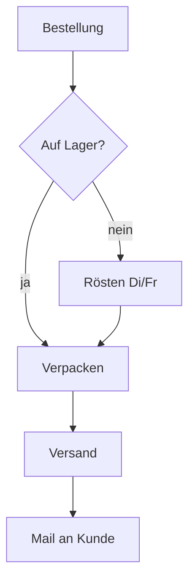
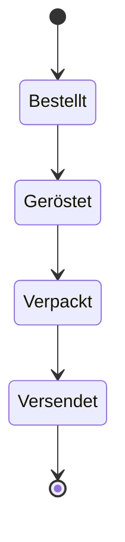
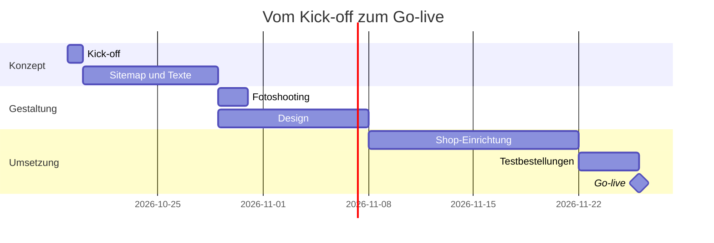

Am 19. Oktober trafen sich Röstwerk Hansen und die Agentur in der Rösterei in Lüneburg, um den
neuen Online-Shop auf den Weg zu bringen. Dieses Protokoll hält Ausgangslage, Entscheidungen,
Zeitplan, Budget und Aufgaben fest — und ist mit genau dem Werkzeug gesetzt, das es
vorführt.[^demo]

[^demo]: Ein fiktives Beispiel. Die Markdown-Quelle liegt als Anhang in diesem PDF.

# Auf einen Blick

> [!WICHTIG]
> Go-live ist am **4. Dezember 2026** — rechtzeitig vor dem Weihnachtsgeschäft. Das Budget von
> **24.800 € netto** ist freigegeben.

| Eckdaten | |
| --- | --- |
| Auftraggeber | Röstwerk Hansen GmbH, Lüneburg |
| Projekt | Online-Shop für Kaffee, Zubehör und Abos |
| Budget | 24.800 € netto |
| Go-live | 04.12.2026 |
| Ansprechpartnerin | Lena Hansen (Geschäftsführung) |

# Teilnehmende und Agenda

| Name | Rolle | Firma |
| ---- | ----- | ----- |
| Lena Hansen | Geschäftsführung | Röstwerk Hansen |
| Jakob Hansen | Röstmeister | Röstwerk Hansen |
| Mara Lindner | Projektleitung | Agentur |
| Tom Berger | Entwicklung | Agentur |

1. Ausgangslage und Ziele
2. Sortiment und Preise
3. Bestellprozess
4. Zeitplan und Budget
5. Aufgaben und offene Fragen

# Mitschrift

## Ausgangslage

Röstwerk Hansen röstet seit 1998 in kleinen Chargen — heute rund 40 Tonnen im Jahr, verkauft im
eigenen Laden und an 30 Cafés. Online gibt es bisher nur eine Visitenkarte. Lena Hansen fasste
es so zusammen:

> "Wer uns einmal probiert hat, will nachbestellen -- und genau das geht im Moment nur per
> Telefon."

Jakob ergänzte, die Kundschaft frage seit Jahren nach einem Abo. Der Shop soll das
Ladengefühl ins Netz bringen: ruhig, ehrlich, mit Geschichten zu Herkunft und Röstung...

## Ziele

- Online-Verkauf von Bohnen und gemahlenem Kaffee (250 g und 1 kg)
  - Mahlgrad bei der Bestellung wählbar: Espresso, Filter, French Press
- Kaffee-Abo mit 2-, 4- oder 6-Wochen-Rhythmus
- Zubehör (Mühlen, Filter, Tassen) — ==zunächst nur 20 Artikel==
- Wiederbestellung mit einem Klick für Bestandskunden

## Sortiment und Preise

Zum Start gehen sechs Sorten online; die Preise gelten pro Packung inklusive 7 % USt.

| Sorte | Herkunft | Röstgrad | 250 g | 1 kg |
| ----- | -------- | :------: | ----: | ---: |
| Hansens Hausmischung | Brasilien, Indien | mittel | 8,90 € | 29,90 € |
| Espresso Lüneburg | Brasilien, Äthiopien | dunkel | 9,50 € | 32,50 € |
| Yirgacheffe | Äthiopien | hell | 11,90 € | 41,00 € |
| Huila | Kolumbien | mittel | 10,50 € | 36,00 € |
| Decaf Mexiko | Mexiko | mittel | 9,90 € | 34,00 € |
| Saisonkaffee | wechselnd | hell | 12,50 € | — |

> [!TIPP]
> Jakob schlägt vor, den Saisonkaffee nur im Abo anzubieten. Das macht das Abo attraktiver und
> hält die Lagermenge klein.

## Wie viel Rohkaffee steckt in einer Packung?

Beim Rösten verliert die Bohne Wasser; der **Röstverlust** $v$ liegt je nach Röstgrad bei 14 bis
20 %. Für eine Packung mit der Röstmenge $m_{r}$ braucht man also die Rohkaffeemenge

$$
m_{g} = \frac{m_{r}}{1 - v}
$$

Für 1 kg Espresso Lüneburg (Röstverlust 18 %, also $v$ = 0,18) sind das rund 1,22 kg Rohkaffee. Diese Zahl geht in
die Kalkulation der Abo-Preise ein.

## Bestellprozess

Der Weg einer Bestellung, wie er im Workshop skizziert wurde:



Jede Packung durchläuft dabei diese Zustände:



> [!HINWEIS]
> Geröstet wird nur dienstags und freitags. Der Shop muss das Lieferdatum deshalb aus dem
> nächsten Rösttag berechnen und **nicht** pauschal „1–2 Tage“ versprechen.

# Zeitplan



| Meilenstein | Datum | Verantwortlich |
| ----------- | :---: | -------------- |
| Sitemap und Texte abgestimmt | 28.10.2026 | Mara Lindner |
| Fotoshooting in der Rösterei | 29.–30.10.2026 | Lena Hansen |
| Design freigegeben | 11.11.2026 | Lena Hansen |
| Testbestellungen abgeschlossen | 01.12.2026 | Tom Berger |
| Go-live | 04.12.2026 | alle |

# Budget

| Pos. | Leistung | Aufwand | Satz | Betrag |
| ---- | -------- | ------- | ---- | ------ |
| 1 | Konzept, Sitemap, Workshop | 24 Std. | 110,00 € | 2.640,00 € |
| 2 | Gestaltung Shop und Produktseiten | 48 Std. | 110,00 € | 5.280,00 € |
| 3 | Shop-Einrichtung, Abo-Funktion, Zahlarten | 96 Std. | 120,00 € | 11.520,00 € |
| 4 | Fotoshooting (2 Tage) inkl. Bildbearbeitung | 1 | 3.200,00 € | 3.200,00 € |
| 5 | Projektmanagement | 20 Std. | 95,00 € | 1.900,00 € |
| | **Summe netto** | | | **24.540,00 €** |
| | Puffer | | | 260,00 € |
| | **Budget netto** | | | **24.800,00 €** |
| | zzgl. 19 % USt. | | | 4.712,00 € |
| | **Budget brutto** | | | **29.512,00 €** |

> [!ACHTUNG]
> Die Abo-Funktion ist der größte Posten. Sollte der Shop-Anbieter sie nicht nativ
> unterstützen, wird eine Erweiterung nötig — Mehrkosten von bis zu 1.500 € sind dann möglich.

# Aufgaben

- [x] Protokoll verschicken – Mara Lindner, bis 20.10.
- [ ] Shop-Anbieter für Abos prüfen – Tom Berger, bis 23.10.
- [ ] Texte zu Herkunft und Röstung liefern – Jakob Hansen, bis 27.10.
- [ ] Fotoshooting vorbereiten (Requisiten, Ablauf) – Lena Hansen, bis 28.10.
- [ ] Versandkosten und Verpackung festlegen – Lena Hansen, bis 30.10.
- [ ] Zahlungsanbieter anbinden – Tom Berger, bis KW 46

## Offene Fragen

- Soll es Geschenkgutscheine geben?
- [ ] Rechtliches: AGB und Widerruf für Abos klären – Lena Hansen, bis 06.11.
- Wie wird der Laden-Bestand mit dem Shop abgeglichen?
- [x] Domain: `roestwerk-hansen.de` ist gesichert

# Anhang

## Glossar

Röstgrad
: Wie lange und wie heiß die Bohne geröstet wird; hell betont Säure und Frucht, dunkel
  Schokolade und Röstaromen.

Single Origin
: Kaffee aus einer einzigen Herkunft, im Gegensatz zur Mischung.

Rohkaffee
: Die ungerösteten, grünen Bohnen — so kommt der Kaffee in die Rösterei.

## Produktdaten für den Shop

So sieht ein Produkt im Export für den Shop aus:

```json
{
  "sku": "ESP-LG-1000",
  "name": "Espresso Lüneburg",
  "weight_g": 1000,
  "roast": "dunkel",
  "price_eur": 32.50,
  "subscription": true
}
```

## Nächste Termine

28. Oktober 2026
11. November 2026
4. Dezember 2026

---

*Protokoll: Mara Lindner. Korrekturen bitte bis 23.10. an die Projektleitung.*
